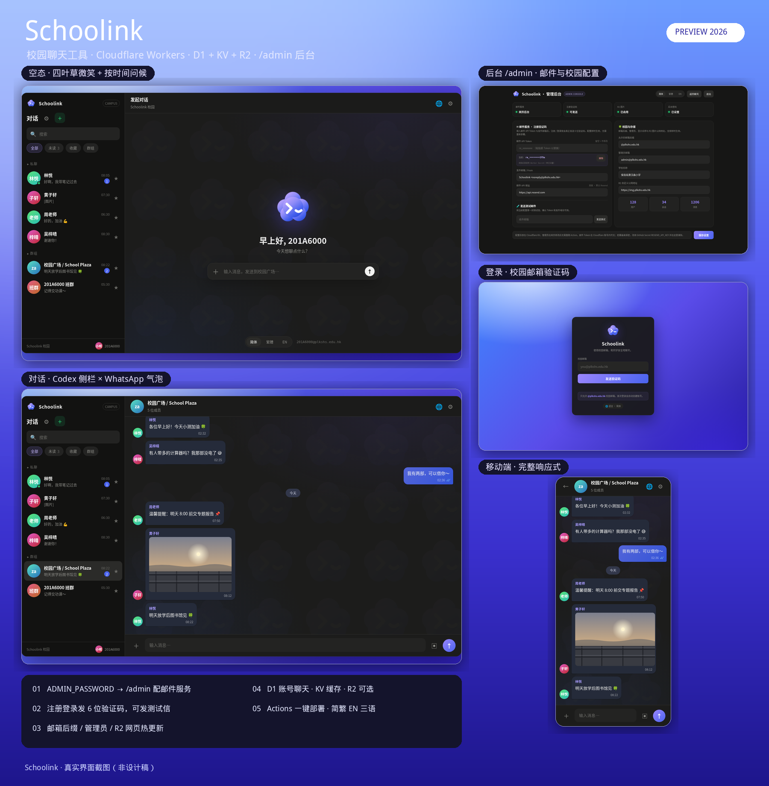

# Schoolink 🍀



一个部署在 **Cloudflare Workers** 上的校园聊天工具。界面是 **Codex 深色工作台 × WhatsApp 对话** 的混合体：左边 Codex 风格的分组会话列表，右边 WhatsApp 风格的聊天气泡；空态正中间是一朵会微笑的四叶草，下面按时间问候（例如 `早上好, 201A6000`）。支持 **简体中文 / 繁體中文 / English** 即时切换。

仓库：<https://github.com/wcvjk8tnz8-create/schoolink>

```
Workers + Static Assets  →  前端单页 + 全部 API（同一个域名，无需 Pages）
D1                       →  账号数据 + 聊天数据（users / threads / thread_members / messages）
KV                       →  缓存层：会话白名单、验证码、最近消息缓存、在线状态、管理员热配置
R2 (Workers 绑定)         →  图片对象；可选，关闭后图片功能自动降级
```

---

## 一、部署：填环境变量 → 跑一次 Action

整套部署已经做进 `.github/workflows/deploy.yml`。**不用在本地装 wrangler、不用手敲 create 命令**，D1 / KV / R2 和建表全部由 `scripts/provision.mjs` 在 CI 里自动完成。

### 1. 在 GitHub 填变量

`Settings → Secrets and variables → Actions`：

**Secrets**（3 个必填，2 个可选）

| 名称 | 必填 | 说明 |
|---|---|---|
| `CLOUDFLARE_API_TOKEN` | ✅ | Cloudflare API Token，权限见下方 |
| `SESSION_SECRET` | ✅ | 一长串随机字符串（如 `openssl rand -hex 32`）。**必须固定**，否则每次部署都会把所有人登出 |
| `ADMIN_PASSWORD` | ✅ | **`/admin` 后台密码**。只作为 Worker Secret 写入，绝不进 `wrangler vars` 或仓库 |
| `RESEND_API_KEY` | ⬜ | 邮件服务兜底。不填也没关系，部署后到 `/admin` 网页填即可 |
| `RESEND_FROM` | ⬜ | 例 `Schoolink <noreply@your-domain.com>`；同样可在 `/admin` 覆盖 |

**Variables**（都有默认值，按需覆盖）

| 名称 | 默认 | 说明 |
|---|---|---|
| `CLOUDFLARE_ACCOUNT_ID` | — | **建议填**，填了之后 `push` 到 main 也会自动部署；不填只能手动触发 |
| `ALLOWED_EMAIL_DOMAINS` | `@plkshs.edu.hk` | 允许的校园邮箱后缀，逗号分隔 |
| `ADMIN_EMAILS` | 自动推导 | 管理员邮箱，逗号分隔 |
| `SCHOOL_NAME` | `Schoolink 校園` | 显示名称 |
| `ENABLE_R2` | `true` | **设成 `false` 就完全跳过 R2** |
| `R2_BUCKET_NAME` | `schoolink-images` | R2 bucket 名 |
| `R2_PUBLIC_BASE_URL` | 空 | R2 自定义域，例 `https://img.plkshs.edu.hk`；留空走 `/api/file` 同源回源 |
| `WORKER_NAME` | `schoolink` | Worker 名 |
| `D1_DATABASE_NAME` | `schoolink-db` | D1 库名 |
| `KV_NAMESPACE_TITLE` | `schoolink-cache` | KV 命名空间标题 |
| `ALLOW_DEV_OTP` | `0` | 生产保持 `0` |
| `CUSTOM_DOMAIN` | 空 | 例 `chat.plkshs.edu.hk`，填了会自动加自定义域路由 |

> 凭据只放 Secrets / Variables，**绝不写进代码或提交记录**。

**API Token 权限**（Cloudflare → My Profile → API Tokens → Create Custom Token）：
`Account · Workers Scripts: Edit`、`Account · D1: Edit`、`Account · Workers KV Storage: Edit`、`Account · Account Settings: Read`；
`ENABLE_R2=true` 再加 `Account · R2: Edit`；用了 `CUSTOM_DOMAIN` 再加 `Zone · Workers Routes: Edit`。

### 2. 跑 Action

`Actions → Deploy Schoolink → Run workflow`。流程依次是：

1. `scripts/provision.mjs` 调 Cloudflare API 幂等准备资源并**自动执行 `schema.sql` 建表**
2. 现场生成 `wrangler.jsonc`，回填真实的 D1 `database_id` / KV `id` 和所有 Variables
3. `wrangler deploy` 部署
4. 写入 Worker secrets（云端即时生效）

跑完在 job Summary 里能看到 Worker 名、D1 / KV / R2 状态和访问地址。

### 3. 关于 R2（重点）

`wrangler r2 bucket create` 遇到已存在的 bucket 会直接报错，让整个 Action 红灯。脚本这样处理：

- **先查再建**：D1 / KV / R2 一律先 list，存在就复用，**绝不重复 create**
- **竞态兜底**：万一 create 撞上 `already exists`，再 list 一次拿回资源继续，不算失败
- **`ENABLE_R2=false` 时完全不碰 R2 API**：不 list、不 create、不写 `r2_buckets` 绑定。这样没开通 R2、Token 没有 R2 权限、或单纯不想要图片功能，都不会失败
- R2 关闭后：前端自动隐藏上传按钮，上传 / 图片回源接口返回 503 友好提示，文字聊天、账号、群组、管理员配置一切正常

配了 R2 后想走自定义公网地址：Cloudflare Dashboard → R2 → bucket → Settings → Custom Domains 绑定域名，再把 `https://img.xxx` 填进 `R2_PUBLIC_BASE_URL` 重跑 Action（或者直接在网页 ⚙ 设置里改，即时生效）。

### 4. 部署完之后：进 /admin 配好注册验证码

1. 打开 `https://<你的 Worker 域名>/admin`，用 `ADMIN_PASSWORD` 登录（**不需要校园邮箱账号**，避免"还没配邮件 → 收不到验证码 → 进不去后台"的死锁）
2. 填 **邮件 API Token**（Resend 的 `re_...`）和 **发件邮箱 / From**（已验证域名的地址）
3. 点「发送测试」确认能收到 → 点「保存设置」
4. 之后注册 / 登录就会真正发送 6 位验证码；首次登录自动建号并加入「校园广场 / School Plaza」

同一页还能改邮箱后缀、管理员邮箱、学校名、R2 公网地址，**全部即时生效，不用重跑 Action、不用重新部署**。想换域名或后缀默认值，改 Variables 再 Run workflow 一次即可。

> `push` 到 main 也会自动部署，但没填 `CLOUDFLARE_ACCOUNT_ID` 时 job 会自动跳过，所以第一次推代码不会红灯；改 README 或 docs 不会触发部署。

---

## 二、/admin 后台与注册验证码

### 为什么要有独立后台

注册验证码依赖邮件服务，但旧流程要求「先在 GitHub Secrets 填 `RESEND_API_KEY`」才能发信。现在把邮件配置搬到网页：

> **两个 API Token 别搞混**：`CLOUDFLARE_API_TOKEN` 只在 GitHub Secrets 里给 Action 用（自动建 D1/KV/R2）；`/admin` 里填的是**邮件 API Token**（Resend 的 `re_...`），专门用来发注册验证码。

```
GitHub Secrets 只留 3 个：CLOUDFLARE_API_TOKEN / SESSION_SECRET / ADMIN_PASSWORD
        ↓ Action 部署（自动建 D1 / KV / R2 + 建表 + 写 secrets）
打开 /admin  →  用 ADMIN_PASSWORD 登录
        ↓
填 邮件 API Token + 发件邮箱  →  发送测试  →  保存
        ↓ 写入 KV CONFIG:app
POST /api/auth/otp/request 读到配置 → 发 6 位验证码 → 注册 / 登录可用
```

优先级：**`/admin` 网页配置 > Worker Secret `RESEND_API_KEY` > 本地 dev OTP**。后台里点「清除」即可回退到 Secret。

### 安全设计

| 项 | 做法 |
|---|---|
| `ADMIN_PASSWORD` | 只存 Cloudflare Worker Secret；不进 `wrangler.jsonc`、不进 git、不返回给浏览器 |
| 后台会话 | 独立 `schoolink_admin` Cookie，HMAC-SHA256 签名 + KV 白名单，2 小时过期，登出即失效 |
| 密码校验 | 恒定时间比较；同 IP 连续失败 5 次锁 10 分钟 |
| Token 回显 | 只回传掩码 `re_••••••••3f9a`，明文只在服务端 `sendMail` 里用 |
| CSRF | 所有写请求校验同源 Origin |

> 网页配置存在 KV，Cloudflare 账号内可见。若要最高保密：把 Token 放 GitHub Secret `RESEND_API_KEY`，并在 `/admin` 点「清除」回退。

### 后台能改什么

- **邮件**：API Token、发件邮箱 From、API 地址（默认 `https://api.resend.com`，可换兼容服务）、一键测试发信
- **校园**：允许邮箱后缀、管理员邮箱、学校名称
- **存储**：R2 自定义公网地址
- **状态卡**：邮件服务 / 注册验证码 / R2 / 后台密码 四项健康状态，加用户/会话/消息统计

---

## 三、本地开发（可选）

```bash
npm install
cp .dev.vars.example .dev.vars      # 填 ADMIN_PASSWORD；本地可把 ALLOW_DEV_OTP 设为 1
# 在 .dev.vars 里填 CLOUDFLARE_API_TOKEN / CLOUDFLARE_ACCOUNT_ID
# 启动后打开 http://localhost:8787/admin 即可配置邮件服务
node scripts/provision.mjs          # 也可本地跑：自动建资源 + 生成配置 + 建表（作用于线上账号）
npm run dev                        # 或只跑本地模拟：npm run db:local && npm run dev
```

`wrangler.jsonc` 在仓库里只是模板（D1 / KV id 为占位符），CI 会覆写它但不会提交回去。

---

## 四、功能对照

| 需求 | 实现 |
|---|---|
| 注册发送验证码 | 校园邮箱 + 6 位 OTP（KV 存 10 分钟、55 秒限流），邮件由 `/admin` 配置的 API Token + 发件邮箱发出；未配置时登录页直接引导去 `/admin` |
| `/admin` 后台 | `ADMIN_PASSWORD` 独立登录，配置邮件 API Token / 发件邮箱 / 后缀 / 管理员 / R2 地址，可一键发测试信 |
| 管理员配置邮箱后缀 | ⚙ 设置或 `/admin` 改 `允许的邮箱后缀`，写进 KV `CONFIG:app`，即时生效；Variables 只是初始兜底。注册/发码严格按 `@` 后缀匹配 |
| 图片走 R2 | `POST /api/upload` → `env.IMAGES.put()`，key 形如 `images/2026/11/<uuid>.png`，返回自定义域 URL；`GET /api/file/*` 兜底回源；R2 关闭则整体降级 |
| D1 + KV 分工 | 账号与聊天全部落 D1；KV 只做缓存 / 会话 / OTP / 在线心跳 / 热配置 |
| Codex × WhatsApp 界面 | 侧栏「置顶 / 私聊 / 群组」分组 + 筛选 chips + 底部状态条；右侧日期胶囊、气泡、双勾已读、壁纸水印、输入框 |
| 中间四叶草微笑 | `public/logo.svg`，紫→蓝渐变六圆叠成四叶草，白色 `>` 眨眼 + 上弯微笑嘴；带轻微浮动动画 |
| 按时间问候 | `早上好, 201A6000` / `早晨, 201A6000` / `Good morning, 201A6000`，学号取账号 `student_id` |
| 中英文切换 | 简 / 繁 / EN 三档，存 `localStorage`，全站文案即时重渲染 |

时段规则（浏览器本地时间）：

| 时间 | 简体 | 繁體 | English |
|---|---|---|---|
| 05:00–11:59 | 早上好 | 早晨 | Good morning |
| 12:00–17:59 | 下午好 | 午安 | Good afternoon |
| 18:00–22:59 | 晚上好 | 晚上好 | Good evening |
| 23:00–04:59 | 夜深了 | 夜深了 | Still up? |

---

## 五、登录流程

1. 输入校园邮箱 → `POST /api/auth/otp/request`：先校验后缀，再限流（55 秒一次），生成 6 位验证码存 KV（10 分钟）。
2. 邮件配置优先读 `/admin` 存在 KV 的设置，其次回退 Worker Secret `RESEND_API_KEY`，用 `sendMail()` 发出 6 位码；本地 `ALLOW_DEV_OTP=1` 时直接回填；三者都没配会返回 503 并提示管理员去 `/admin`，不会静默放行。
3. `POST /api/auth/otp/verify` → 首次登录自动建号（学号 + 显示名），并加入默认群组。
4. 签发 HMAC-SHA256 会话 token（`HttpOnly / Secure / SameSite=Lax` Cookie，30 天），同时在 KV 存白名单，登出即失效。
5. 所有写接口校验同源 Origin；会话列表、消息接口都校验 `thread_members` 成员身份。

---

## 六、API 一览

| Method | Path | 说明 |
|---|---|---|
| GET | `/api/config` | 公开配置（后缀、R2 地址/是否启用、学校名、邮件是否已配置、后台密码是否已设） |
| POST | `/api/admin/panel/login` / `logout` | `/admin` 用 `ADMIN_PASSWORD` 登录 / 登出，签发独立 2 小时会话 |
| GET | `/api/admin/panel/state` | 后台状态：配置（Token 只给掩码）+ 用户/会话/消息统计 |
| POST | `/api/admin/panel/config` | 热更新邮件 Token / From / API 地址 / 后缀 / 管理员 / 校名 / R2 地址 |
| POST | `/api/admin/panel/test-mail` | 用当前配置发一封测试验证码邮件 |
| POST | `/api/auth/otp/request` / `verify` | 验证码登录 |
| GET | `/api/me` · POST `/api/logout` | 当前用户 / 登出 |
| GET | `/api/users` · POST `/api/presence` | 同学列表 / 在线心跳 |
| GET/POST | `/api/threads` | 会话列表 / 发起私聊或建群 |
| GET/POST | `/api/threads/:id/messages` | 最近 80 条（KV 缓存 15s）/ 发消息；`?after=` 走 D1 增量 |
| POST | `/api/threads/:id/read` | 清未读 |
| POST | `/api/upload` | 图片写 R2，≤10MB（R2 关闭时 503） |
| GET | `/api/file/*` | 未配自定义域时的图片回源 |
| GET/POST | `/api/admin/config` | 管理员读取 / 热更新配置 + 数据量统计 |

前端每 2.5 秒增量拉消息、9 秒刷会话列表、30 秒报在线，不依赖 WebSocket 或 Durable Objects。

---

## 七、上线前建议

- **实时性**：现在是轮询。要真·推送可把消息接口换成 Durable Objects + WebSocket，前端逻辑不用动。
- **KV 最终一致性**：会话白名单与热配置在边缘可能有秒级延迟；如需严格即时吊销，把 session 表挪到 D1。
- **邮件**：生产必须配好邮件服务（`/admin` 网页配置或 Secret `RESEND_API_KEY` 二选一），否则注册拿不到验证码；发件域名需在 Resend 验证通过。
- **后台密码**：`ADMIN_PASSWORD` 要够长且只放 Secret；连续 5 次输错会锁 10 分钟。
- **内容安全**：目前没有图片鉴黄、敏感词、举报与封禁；校园场景建议补审核和管理员删除接口。
- **图片**：限制 10MB、只允许 png/jpg/webp/gif/avif/heic；SVG 被拒（防 XSS）。R2 对象设 immutable 强缓存，key 带 UUID 不会冲突。

---

## 八、目录

```
schoolink/
├─ .github/workflows/deploy.yml   # 填环境变量 → 自动建 D1/KV/R2 → 部署
├─ scripts/provision.mjs          # 幂等资源准备 + 建表 + 生成 wrangler 配置
├─ wrangler.jsonc                 # 本地开发模板（CI 会覆写）
├─ schema.sql                     # D1 建表（全 IF NOT EXISTS）
├─ docs/preview.png               # 综合预览（含 /admin 后台）
├─ docs/preview-{hero,chat,login,admin,admin-login,mobile}.png
├─ src/index.js                   # 路由、鉴权、OTP 发信、上传、/admin API
├─ src/auth.js                    # HMAC 会话（用户/后台两套）、OTP、后缀校验、恒定时间比较
├─ src/store.js                   # D1 / KV 数据访问层、热配置、sendMail
├─ public/admin.html · admin.js · admin.css   # /admin 后台
├─ public/index.html · style.css · app.js · logo.svg · favicon.svg
└─ .dev.vars.example
```
